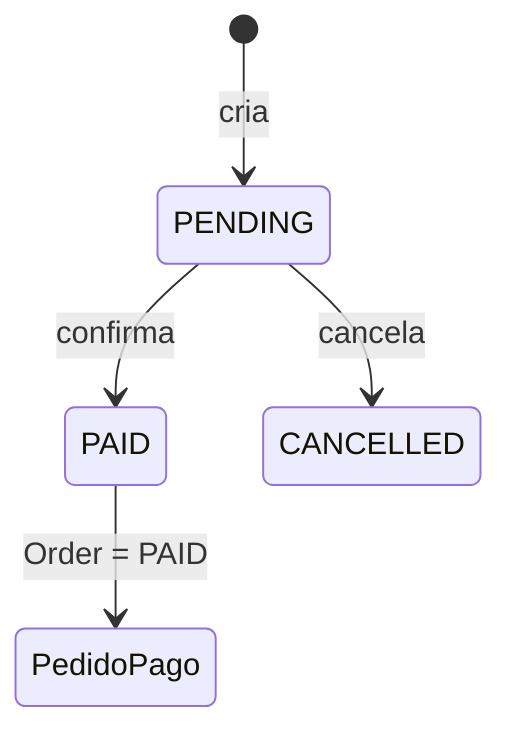
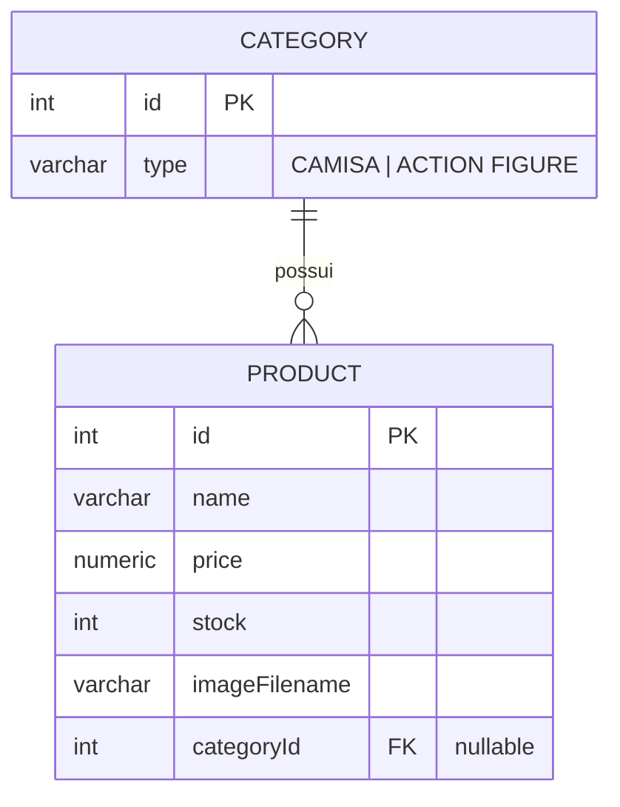
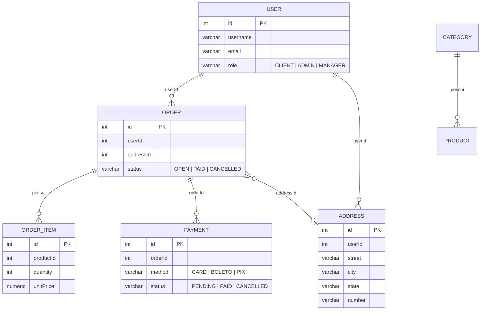

# Loja API

API REST para gerenciamento de uma loja virtual, desenvolvida com **NestJS**, **TypeORM** e **PostgreSQL**. Possui produtos, pedidos, usuários com papéis, endereços, pagamentos (fake) e categorias, com autenticação JWT, regras de negócio e documentação Swagger.

> ## Autoria e uso de IA
>
> - **Linha P** (produtos, pedidos, login/registro, papéis e upload de imagem) — desenvolvida por mim **a partir das videoaulas disponibilizadas pelo professor no YouTube**.
> - **Linha A** (pacotes **Endereços**, **Pagamento fake** e **Categorias**, mais as features A dos capítulos) — desenvolvida **com auxílio de IA**.
>
> Detalhes na seção [Uso de IA](#12-uso-de-ia).

---

## Sumário

1. [Tecnologias](#1-tecnologias)
2. [Instalação e execução](#2-instalação-e-execução)
3. [Autenticação, perfis e política de erros](#3-autenticação-perfis-e-política-de-erros)
4. [Linha P — base da loja](#4-linha-p--base-da-loja)
5. [Pacote Endereços](#5-pacote-endereços)
6. [Pacote Pagamento fake](#6-pacote-pagamento-fake)
7. [Pacote Categorias (Catálogo rico)](#7-pacote-categorias-catálogo-rico)
8. [Features A dos capítulos](#8-features-a-dos-capítulos)
9. [Documentação Swagger](#9-documentação-swagger)
10. [Estrutura dos módulos](#10-estrutura-dos-módulos)
11. [Testes](#11-testes)
12. [Uso de IA](#12-uso-de-ia)

---

## 1. Tecnologias

| Tecnologia | Uso |
|---|---|
| Node.js + TypeScript | Ambiente de execução e linguagem |
| NestJS | Framework da API (arquitetura modular) |
| TypeORM | ORM (`synchronize: true`, tabelas criadas automaticamente) |
| PostgreSQL | Banco de dados relacional |
| Passport + JWT | Autenticação (access token e refresh token) |
| bcrypt | Hash de senhas e do refresh token |
| class-validator / class-transformer | Validação dos DTOs |
| Multer | Upload de imagens de produto |
| Swagger (`@nestjs/swagger`) | Documentação interativa em `/api` |
| Jest / Supertest | Testes (estrutura padrão do Nest) |
| Postman | Testes manuais das rotas |

As versões das dependências estão no `package.json`.

---

## 2. Instalação e execução

### Pré-requisitos

- Node.js e npm instalados
- PostgreSQL instalado e em execução

### Passo a passo

```bash
git clone https://github.com/leoxLF/loja-api.git
cd loja-api
npm install
```

### Banco de dados e `.env`

Crie um banco no PostgreSQL (ex.: `loja_api`) e crie um arquivo `.env` na raiz:

```env
# Banco de dados
DB_HOST=localhost
DB_PORT=5432
DB_USERNAME=loja
DB_PASSWORD=sua_senha
DB_DATABASE=loja_api

# JWT (obrigatórios)
JWT_SECRET=troque-por-um-segredo-grande
JWT_REFRESH_SECRET=troque-por-um-segredo-grande-refresh

# JWT (opcionais — valores padrão entre parênteses)
JWT_EXPIRES_IN=15m          # access token (padrão 15m)
JWT_REFRESH_EXPIRES_IN=1d   # refresh token (padrão 1d)

# Opcional
PORT=3000                   # padrão 3000
```

> Não versione o `.env` (ele já está no `.gitignore`). Os nomes das variáveis são os lidos em `src/app.module.ts` e no módulo de autenticação.

### Executar

```bash
npm run start:dev
```

A API sobe em `http://localhost:3000` e o Swagger em `http://localhost:3000/api`.

### Criando os usuários do laboratório (não há seed automático)

O projeto **não possui script de seed**. Todo usuário criado por `POST /auth/register` recebe o papel `CLIENT`. Para obter `ADMIN` e `MANAGER`, registre os usuários e promova-os direto no banco:

```bash
# 1) Registrar os três usuários
for u in cli ana mgr; do
  curl -X POST http://localhost:3000/auth/register \
    -H "Content-Type: application/json" \
    -d "{\"username\":\"$u\",\"email\":\"$u@loja.com\",\"password\":\"secret123\"}"
done
```

```sql
-- 2) Promover (psql ou qualquer cliente SQL)
UPDATE users SET role = 'ADMIN'   WHERE username = 'ana';
UPDATE users SET role = 'MANAGER' WHERE username = 'mgr';
```

| Papel | Usuário | Senha |
|---|---|---|
| CLIENT | `cli` | `secret123` |
| ADMIN | `ana` | `secret123` |
| MANAGER | `mgr` | `secret123` |

> Depois de promover, faça **login de novo**: o papel vai dentro do JWT.

### Obtendo o token

```bash
curl -X POST http://localhost:3000/auth/login \
  -H "Content-Type: application/json" \
  -d '{"username":"ana","password":"secret123"}'
```

Resposta (`201`):

```json
{ "access_token": "...", "refresh_token": "..." }
```

Nos exemplos abaixo, `SEU_TOKEN` é o `access_token` e `TOKEN_ADMIN` é o `access_token` de um ADMIN.

---

## 3. Autenticação, perfis e política de erros

Rotas protegidas exigem o cabeçalho:

```http
Authorization: Bearer SEU_TOKEN
```

### Perfis

| Perfil | O que pode |
|---|---|
| **Visitante** (sem token) | Listar/consultar produtos, ver imagem de produto, `/catalog/summary`, `/health/version`, registrar e logar |
| **CLIENT** | Tudo do visitante + categorias (somente leitura), criar pedidos, gerenciar **os próprios** endereços, pagar **os próprios** pedidos, ver **os próprios** pagamentos |
| **MANAGER** | `PUT` em produtos, listar **todos** os pedidos. **Não** pode `DELETE` de produto |
| **ADMIN** | Tudo: CRUD de produtos, upload de imagem, CRUD de categorias, associar categoria, listar todos os pagamentos/pedidos, excluir pagamento |

### Política de erro para recurso de outro usuário

> **Política adotada: `404 Not Found`.**
> Quando um usuário tenta acessar endereço, pedido ou pagamento que **não é dele**, a API responde `404`, como se o recurso não existisse (não revela que ele existe).
> `403` é usado apenas quando falta **papel** (ex.: CLIENT chamando rota de ADMIN).

### Códigos HTTP

| Código | Significado |
|---|---|
| 200 / 201 / 204 | Sucesso / criado / sem conteúdo |
| 400 | Dados inválidos ou regra de negócio violada (ex.: estoque insuficiente, pedido não `OPEN`) |
| **401** | **Não autenticado** — token ausente, inválido ou expirado |
| **403** | **Autenticado, mas sem permissão** — papel insuficiente |
| 404 | Recurso inexistente **ou** pertencente a outro usuário |
| 409 | Usuário/e-mail já cadastrado |

---

## 4. Linha P — base da loja

> Desenvolvida a partir das videoaulas do professor.

| Método | Rota | Acesso | Descrição |
|---|---|---|---|
| POST | `/auth/register` | Público | Registra usuário (papel `CLIENT`) |
| POST | `/auth/login` | Público | Retorna `access_token` e `refresh_token` |
| GET | `/products` | Público | Lista produtos (filtros `q`, `minPrice`, `maxPrice`) |
| GET | `/products/:id` | Público | Consulta produto |
| POST | `/products` | ADMIN | Cria produto |
| PUT | `/products/:id` | ADMIN, MANAGER | Atualiza produto (corpo completo) |
| DELETE | `/products/:id` | ADMIN | Exclui produto |
| POST | `/products/:id/image` | ADMIN | Upload de **uma** imagem (JPEG/PNG/WEBP, até 2 MB, campo `file`) |
| GET | `/products/:id/image` | Público | Retorna a imagem do produto |
| POST | `/orders` | JWT | Cria pedido (baixa o estoque) |
| GET | `/orders` | ADMIN, MANAGER | Lista todos os pedidos |
| GET | `/orders/my` | JWT | Lista os pedidos do usuário logado |
| GET | `/orders/:id` | — | Consulta pedido |
| POST | `/orders/:id/cancel` | — | Cancela pedido `OPEN` e devolve o estoque |

**Exemplos**

```bash
# Criar produto (ADMIN)
curl -X POST http://localhost:3000/products \
  -H "Authorization: Bearer TOKEN_ADMIN" \
  -H "Content-Type: application/json" \
  -d '{"name":"Camisa Preta","price":79.9,"stock":10}'

# Criar pedido (qualquer usuário logado)
curl -X POST http://localhost:3000/orders \
  -H "Authorization: Bearer SEU_TOKEN" \
  -H "Content-Type: application/json" \
  -d '{"items":[{"productId":1,"quantity":2}]}'

# Meus pedidos
curl http://localhost:3000/orders/my -H "Authorization: Bearer SEU_TOKEN"

# Upload de imagem (ADMIN)
curl -X POST http://localhost:3000/products/1/image \
  -H "Authorization: Bearer TOKEN_ADMIN" \
  -F "file=@./foto.png"
```

**Status do pedido:** `OPEN` → `PAID` | `CANCELLED`.
Se a quantidade pedida for maior que o estoque, a API responde `400` com a mensagem `Estoque insuficiente para o produto X. Quantidade em estoque: N`.

---

## 5. Pacote Endereços

> Desenvolvido com auxílio de IA.

### Objetivo

Permitir que o cliente gerencie os próprios endereços e associe um deles a um pedido seu.

### Histórias de usuário

| ID | Como… | Quero… |
|---|---|---|
| US-E1 | Cliente | cadastrar um endereço |
| US-E2 | Cliente | ver só os **meus** endereços |
| US-E3 | Cliente | editar ou apagar o **meu** endereço |
| US-E4 | Cliente | ligar endereço **meu** a pedido **meu** |
| US-E5 | Cliente | que ninguém mexa no meu endereço |

### Regras de negócio

1. Todas as rotas exigem JWT.
2. O `userId` do endereço vem **do token**, nunca do corpo da requisição.
3. Consultar, atualizar e excluir só funciona para endereços do próprio usuário; caso contrário → `404`.
4. Para associar endereço a pedido, **pedido e endereço devem ser do mesmo usuário**; caso contrário → `404`.

### Rotas

| Método | Rota | Descrição |
|---|---|---|
| POST | `/addresses` | Cadastrar endereço |
| GET | `/addresses` | Listar os próprios endereços |
| GET | `/addresses/:id` | Consultar um endereço próprio *(extra)* |
| PUT | `/addresses/:id` | Atualizar endereço (campos opcionais) |
| DELETE | `/addresses/:id` | Excluir endereço (`204`) |
| PATCH | `/orders/:id/address` | Associar endereço ao pedido |

### Campos (`CreateAddressDto`)

| Campo | Tipo | Regra |
|---|---|---|
| `street` | string | até 150 caracteres |
| `city` | string | até 100 caracteres |
| `state` | string | exatamente 2 caracteres (ex.: `PE`) |
| `number` | string | até 20 caracteres |

### Exemplos

```bash
# Cadastrar
curl -X POST http://localhost:3000/addresses \
  -H "Authorization: Bearer SEU_TOKEN" \
  -H "Content-Type: application/json" \
  -d '{"street":"Rua das Flores","city":"Recife","state":"PE","number":"150A"}'

# Listar os meus
curl http://localhost:3000/addresses -H "Authorization: Bearer SEU_TOKEN"

# Atualizar
curl -X PUT http://localhost:3000/addresses/1 \
  -H "Authorization: Bearer SEU_TOKEN" \
  -H "Content-Type: application/json" \
  -d '{"city":"Olinda"}'

# Excluir
curl -X DELETE http://localhost:3000/addresses/1 \
  -H "Authorization: Bearer SEU_TOKEN"

# Associar ao pedido
curl -X PATCH http://localhost:3000/orders/1/address \
  -H "Authorization: Bearer SEU_TOKEN" \
  -H "Content-Type: application/json" \
  -d '{"addressId":1}'
```

---

## 6. Pacote Pagamento fake

> Desenvolvido com auxílio de IA.

### Objetivo

Simular o pagamento de pedidos. **Não há gateway externo**: o pagamento é salvo no PostgreSQL e, ao ser confirmado, o pedido muda de status.

### Histórias de usuário

| ID | Como… | Quero… |
|---|---|---|
| US-P1 | Cliente | pagar (`CARD` / `BOLETO` / `PIX`) um pedido **meu** `OPEN` |
| US-P2 | Cliente | não ter dois pagamentos ativos no mesmo pedido |
| US-P3 | Cliente | listar **meus** pagamentos |
| US-P3b | Administrador | listar pagamentos de todos |
| US-P4 | Dono do pedido ou ADMIN | marcar o pagamento como `PAID` (pedido também vira `PAID`) |
| US-P5 | Administrador | remover pagamento |
| US-P6 | Sistema | barrar pagamento se o pedido não estiver `OPEN` |

### Regras de negócio

1. Só o **dono do pedido** cria pagamento para ele (pedido de outro → `404`).
2. Só pedidos `OPEN` recebem pagamento (senão `400`).
3. **Um pagamento ativo por pedido**: ativo = `PENDING` ou `PAID` (senão `400`). Um pagamento `CANCELLED` libera criar outro.
4. O pagamento nasce `PENDING`.
5. Métodos: `CARD`, `BOLETO`, `PIX`. O método **não muda** depois de criado.
6. Só pagamento `PENDING` pode ser alterado; ele vai para `PAID` ou `CANCELLED` (senão `400`).
7. `PENDING → PAID` também muda `Order.status` para `PAID`.
8. `PATCH /payments/:id/status`: só o **dono do pedido** ou **ADMIN**.
9. `GET /payments`: CLIENT vê só os próprios; **ADMIN vê todos**.
10. `DELETE /payments/:id`: **somente ADMIN**.

### Fluxo de status



### Rotas

| Método | Rota | Permissão |
|---|---|---|
| POST | `/orders/:id/payments` | JWT (dono do pedido) |
| GET | `/payments` | JWT (cliente: próprios · ADMIN: todos) |
| PATCH | `/payments/:id/status` | JWT (dono do pedido ou ADMIN) |
| DELETE | `/payments/:id` | ADMIN |

### Exemplos

```bash
# Criar pagamento
curl -X POST http://localhost:3000/orders/1/payments \
  -H "Authorization: Bearer SEU_TOKEN" \
  -H "Content-Type: application/json" \
  -d '{"method":"PIX"}'

# Listar
curl http://localhost:3000/payments -H "Authorization: Bearer SEU_TOKEN"

# Confirmar (pedido também vira PAID)
curl -X PATCH http://localhost:3000/payments/1/status \
  -H "Authorization: Bearer SEU_TOKEN" \
  -H "Content-Type: application/json" \
  -d '{"status":"PAID"}'

# Cancelar
curl -X PATCH http://localhost:3000/payments/1/status \
  -H "Authorization: Bearer SEU_TOKEN" \
  -H "Content-Type: application/json" \
  -d '{"status":"CANCELLED"}'

# Excluir (ADMIN)
curl -X DELETE http://localhost:3000/payments/1 \
  -H "Authorization: Bearer TOKEN_ADMIN"
```

---

## 7. Pacote Categorias (Catálogo rico)

> Desenvolvido com auxílio de IA.

### Objetivo

Organizar o catálogo em categorias e associar produtos a elas.

### Histórias de usuário

| ID | Como… | Quero… |
|---|---|---|
| US-C1 | Administrador | CRUD de categorias |
| US-C2 | Cliente | ver categorias e produtos |
| US-C3 | Administrador | associar produto ↔ categoria |
| US-C4 | Cliente | não conseguir alterar categorias |

### Regras de negócio

1. Criar, atualizar e excluir categoria → **somente ADMIN** (CLIENT recebe `403`).
2. Associar categoria a produto → **somente ADMIN**.
3. Consultar categorias e seus produtos → qualquer usuário **autenticado**.
4. Uma categoria tem vários produtos; um produto tem no máximo uma categoria.
5. O `id` da categoria é gerado pelo banco.
6. Tipos permitidos: `CAMISA` e `ACTION FIGURE` (validado no DTO).

### Rotas

| Método | Rota | Permissão |
|---|---|---|
| POST | `/categories` | ADMIN |
| GET | `/categories` | JWT |
| GET | `/categories/:id` | JWT |
| GET | `/categories/:id/products` | JWT |
| PUT | `/categories/:id` | ADMIN |
| DELETE | `/categories/:id` | ADMIN |
| PATCH | `/products/:id/category` | ADMIN |

### Exemplos

```bash
# Criar
curl -X POST http://localhost:3000/categories \
  -H "Authorization: Bearer TOKEN_ADMIN" \
  -H "Content-Type: application/json" \
  -d '{"type":"CAMISA"}'

# Listar / consultar / produtos da categoria
curl http://localhost:3000/categories          -H "Authorization: Bearer SEU_TOKEN"
curl http://localhost:3000/categories/1        -H "Authorization: Bearer SEU_TOKEN"
curl http://localhost:3000/categories/1/products -H "Authorization: Bearer SEU_TOKEN"

# Atualizar
curl -X PUT http://localhost:3000/categories/1 \
  -H "Authorization: Bearer TOKEN_ADMIN" \
  -H "Content-Type: application/json" \
  -d '{"type":"ACTION FIGURE"}'

# Excluir
curl -X DELETE http://localhost:3000/categories/1 \
  -H "Authorization: Bearer TOKEN_ADMIN"

# Associar categoria a um produto
curl -X PATCH http://localhost:3000/products/1/category \
  -H "Authorization: Bearer TOKEN_ADMIN" \
  -H "Content-Type: application/json" \
  -d '{"categoryId":1}'
```

### Diagrama — Category e Product



### Modelo geral (visão do banco)

`Product → Category` é a única chave estrangeira real. As demais ligações são feitas por coluna (`userId`, `orderId`, `addressId`) e validadas nos services.



---

## 8. Features A dos capítulos

| Cap. | Feature | Rota | Status |
|---|---|---|---|
| 1 | Versionamento | `GET /health/version` | ✅ |
| 2 | Busca por nome | `GET /products?q=` | ✅ |
| 2 | PATCH parcial de produto | `PATCH /products/:id` | ✅ *(ver observações)* |
| 2.1 | `PatchProductDto` com `PartialType` | — | ⚠️ usa `UpdateProductDto` como base |
| 3 | Resumo do catálogo | `GET /catalog/summary` | ✅ |
| 4 | Diagrama de Category | seção 7 | ✅ |
| 5 | Categorias | seção 7 | ✅ |
| 5.1 | Status do pedido e estoque | `PATCH /orders/:id/status` | ❌ não implementado |
| 6 | `/auth/me` e refresh | `GET /auth/me`, `POST /auth/refresh` | ✅ |
| 7 | Role `MANAGER` | `PUT`/`GET /orders` | ✅ |
| 9 | Galeria de imagens | `POST/DELETE /products/:id/images` | ❌ não implementado |

### Cap. 1 — Versionamento

```bash
curl http://localhost:3000/health/version
# {"name":"loja-api","version":"0.0.1"}
```

### Cap. 2 — Busca e PATCH de produto

```bash
# Busca por substring do nome (sem diferenciar maiúsculas)
curl "http://localhost:3000/products?q=camisa"

# Faixa de preço (opcional, combinável com q)
curl "http://localhost:3000/products?q=camisa&minPrice=10&maxPrice=100"

# PATCH com corpo parcial — só altera o que for enviado
curl -X PATCH http://localhost:3000/products/1 \
  -H "Authorization: Bearer SEU_TOKEN" \
  -H "Content-Type: application/json" \
  -d '{"price":59.9}'
```

### Cap. 3 — Resumo do catálogo

```bash
curl http://localhost:3000/catalog/summary
# {"totalProducts":3,"totalStockUnits":42}
```

### Cap. 5.1 — Status do pedido e estoque

Implementado hoje:

- Pedido com estoque insuficiente → `400` com mensagem de domínio (`Estoque insuficiente para o produto X…`).
- O estoque é baixado ao criar o pedido, dentro de uma transação.
- Cancelamento via `POST /orders/:id/cancel`: só pedidos `OPEN`; devolve o estoque; pedido `PAID` **não** pode ser cancelado (`400`).
- Pedido vira `PAID` automaticamente quando o pagamento é confirmado.

```bash
curl -X POST http://localhost:3000/orders/1/cancel
```

**Falta:** a rota `PATCH /orders/:id/status` com body `{ "status" }` 

### Cap. 6 — `/auth/me` e refresh

O login devolve **access** e **refresh** tokens. O refresh token é validado por assinatura **e** comparado com o hash salvo no usuário.

```bash
# Dados do usuário logado
curl http://localhost:3000/auth/me -H "Authorization: Bearer SEU_TOKEN"
# {"userId":1,"username":"cli","email":"cli@loja.com","role":"CLIENT"}

# Novo access token
curl -X POST http://localhost:3000/auth/refresh \
  -H "Content-Type: application/json" \
  -d '{"refresh_token":"SEU_REFRESH_TOKEN"}'
# {"access_token":"..."}
```

### Cap. 7 — Role `MANAGER`

| Operação | MANAGER |
|---|---|
| `PUT /products/:id` | ✅ permitido |
| `DELETE /products/:id` | ❌ `403` |
| `GET /orders` (todos os pedidos) | ✅ permitido |

```bash
# permitido
curl -X PUT http://localhost:3000/products/1 \
  -H "Authorization: Bearer TOKEN_MANAGER" -H "Content-Type: application/json" \
  -d '{"name":"Camisa Azul","price":69.9,"stock":8}'

# 403
curl -X DELETE http://localhost:3000/products/1 -H "Authorization: Bearer TOKEN_MANAGER"

# lista todos
curl http://localhost:3000/orders -H "Authorization: Bearer TOKEN_MANAGER"
```

### Cap. 9 — Galeria de imagens

**Não implementado.** Hoje existe apenas a imagem **única** do produto (`POST /products/:id/image`, ver seção 4).

---

## 9. Documentação Swagger

Com a aplicação em execução: **`http://localhost:3000/api`**

Para testar rotas protegidas:

1. Faça login e copie o `access_token`.
2. Clique em **Authorize** e cole o token.
3. Execute a operação.

O Swagger lista rotas, métodos, parâmetros, corpos (com exemplos e valores permitidos dos DTOs) e respostas HTTP. Rotas de pagamentos, categorias e `POST /products` já declaram `@ApiBearerAuth()`;

---

## 10. Estrutura dos módulos

```text
src/
├── auth/         # login, registro, refresh, /auth/me, JWT, guards e roles
├── products/     # CRUD de produtos, busca, PATCH, imagem, associação de categoria
├── orders/       # pedidos, itens, estoque, cancelamento, endereço do pedido
├── addresses/    # endereços do cliente
├── payments/     # pagamento fake
├── categories/   # categorias
├── catalog/      # /catalog/summary
├── app.controller.ts   # "/" e /health/version
├── app.module.ts
└── main.ts       # ValidationPipe global e Swagger
```

| Módulo | Responsabilidade |
|---|---|
| Auth | Autenticação (JWT access/refresh) e autorização por papel (`RolesGuard` + `@Roles`) |
| Products | Produtos, imagem e associação a categoria |
| Orders | Pedidos, itens, estoque e vínculo com endereço |
| Addresses | Endereços do usuário autenticado |
| Payments | Criação e ciclo de vida dos pagamentos |
| Categories | Categorias e seus produtos |
| Catalog | Resumo agregado do catálogo |

**Caminho típico de uma requisição:** `controller` (rota + guards + DTO) → `service` (regra de negócio) → repositório TypeORM → entidade/PostgreSQL.

Exemplo — `PATCH /payments/:id/status`: `PaymentsController.updateStatus` → `PaymentsService.updateStatus` (verifica dono/ADMIN, status `PENDING`, atualiza `Order`) → tabelas `payments` e `orders`.

---

## 11. Testes

### Manuais (Postman)

- **Endereços:** cadastro, listagem própria, atualização, exclusão, associação ao pedido, bloqueio de endereço/pedido de outro usuário.
- **Pagamentos:** criação, bloqueio de segundo pagamento ativo, confirmação (pedido vira `PAID`), cancelamento, bloqueio de usuário sem permissão, exclusão por ADMIN.
- **Categorias:** CRUD, listagem de produtos por categoria, associação a produto, `403` para CLIENT em rotas de ADMIN.
- **Auth/papéis:** login, `/auth/me`, refresh, `MANAGER` (`PUT` ok, `DELETE` → `403`).

### Automatizados

```bash
npm test          # unitários (Jest)
npm run test:e2e  # e2e (exige banco configurado)
npm run lint
```

> Os testes automatizados do projeto ainda são os gerados pelo Nest;

---

## 12. Uso de IA

| Parte | Como foi feita |
|---|---|
| **Linha P** | Feita por mim, acompanhando as **videoaulas do professor no YouTube**. |
| **Linha A** (Endereços, Pagamento fake, Categorias e features A) | Feita **com auxílio de IA**. |
| **README** | Escrito/atualizado com auxílio de IA, conferido com o código. |

- **Ferramenta(s) utilizada(s):** Claude (Anthropic) — ChatGPT.
- **Onde a IA ajudou:** estrutura e implementação dos módulos de endereços, pagamentos e categorias; DTOs e anotações do Swagger; regras de negócio; documentação.
- **O que eu fiz/alterei:** linha P completa; revisão do código gerado; testes manuais no Postman e no Postgres;

